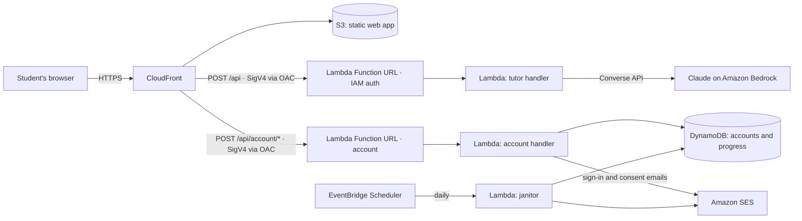

# SumDeTing 🇧🇧 — Socratic AI Math Tutor

**Live:** https://sumdeting.246labs.cloud

A Bajan AI math tutor that refuses to just give you the answer. SumDeTing uses Claude on Amazon Bedrock with a Socratic system prompt: it asks what you've tried, points at where your work went wrong, and guides you to the solution one hint at a time. Math renders properly with KaTeX.

Built for Barbadian students: the tutor knows the local journey from Common Entrance (BSSEE) through CSEC/CXC Mathematics to CAPE, encourages in a warm Bajan voice while keeping every mathematical step in clear standard English, and uses everyday Barbadian contexts (BBD prices, bus fares, cricket) in its examples.

**Stack:** Claude (Amazon Bedrock Converse API) · AWS Lambda (Function URL) · S3 + CloudFront (OAC) · OpenTofu (in tofu-or-not-tofu) · Docker (hardened local runtime)

One codebase, two runtimes: `backend/tutor.mjs` powers both the serverless Lambda deployment and a hardened Docker container for local development.

## Architecture



The frontend is a single HTML page. KaTeX, marked, DOMPurify and the brand fonts are self-hosted under `web/vendor/`, so the CSP allows only the site's own origin. The backend is one Node.js Lambda that validates the conversation, applies the Socratic tutoring prompt, and calls the Bedrock Converse API. Chats are never stored server-side: the conversation lives in the student's browser (localStorage, 24h) so a refresh doesn't lose their session. Accounts are optional. A signed-in student's practice progress (topics, problems solved, streak, preferences) and profile details are stored in DynamoDB so it follows them across devices; an account Lambda handles sign-in (emailed links and codes via SES), parent and guardian access and under-13 parental consent, and an EventBridge Scheduler janitor deletes expired and inactive data. See the [privacy notice draft](web/privacy.html) and the [launch runbook](docs/launch-runbook.md).

## Why Socratic?

Tutoring tools that hand out answers optimize for homework completion, not learning. The system prompt enforces pedagogy: never reveal the final answer, one hint per turn, locate the student's error and ask a question about it, confirm and recap only once the student gets there themselves. Prompt design is the core of this project; see `SYSTEM_PROMPT` in `backend/tutor.mjs`.

## Why Bajan?

Most AI tutors default to US curricula and contexts. SumDeTing is syllabus-aware for the Caribbean (CXC methods for CSEC students, not whatever a generic model assumes) and meets students in a familiar voice. The persona rules are deliberate: dialect for warmth and encouragement only, standard English for every mathematical statement, and no caricature.

## Run locally with Docker

The same tutor logic (`backend/tutor.mjs`) runs in a hardened container for local development and demos. You need AWS credentials with Bedrock access (via `~/.aws` or environment variables). Use Docker Engine 28.0.0 or later: the port is published on `127.0.0.1` only, and older Linux engines don't fully isolate localhost-published ports from the local network.

```bash
docker compose up --build
# open http://localhost:8080
```

The image follows container-hardening practice: multi-stage build, non-root `node` user, read-only filesystem, all capabilities dropped, `no-new-privileges`, and a healthcheck on `/healthz`.

### Accounts in local development

```bash
ACCOUNT_DEV=1 node server.mjs
# or, in the container:
ACCOUNT_DEV=1 docker compose up --build
```

`ACCOUNT_DEV=1` swaps DynamoDB and SES for an in-memory store and a dev outbox. Emails the app would send (sign-in links, codes, consent requests) are readable at `http://localhost:8080/api/account/_dev/outbox`. Data is lost on restart.

## Tests

```bash
cd backend && npm test                      # account backend unit tests
cd e2e && npm ci && npx playwright install chromium && npx playwright test   # browser tests
```

The end-to-end suite starts its own server with `ACCOUNT_DEV=1` on port 8099. Before a public launch, work through [docs/launch-runbook.md](docs/launch-runbook.md).

## Deploy to AWS

Infrastructure no longer lives in this repo. It is managed in [chrisfixesit/tofu-or-not-tofu](https://github.com/chrisfixesit/tofu-or-not-tofu) under `accounts/eportfolio-prod/sumdeting` (the accounts feature arrives with tofu PR #40: the `sumdeting-account` and `sumdeting-janitor` Lambdas, the `sumdeting-accounts` table, SES, and the CloudFront `/api/account/*` behaviour). DKIM records are a separate PR in that repo's `management/dns`, and the `sumdeting-github-deploy` role's access to the new functions is a separate github-deploy PR. The old `infra/` folder is retired: do not apply it.

Code and site files ship through `.github/workflows/deploy.yml` on merge to `main` (behind the `production` environment approval). It updates the three Lambdas from one zip, uploads the site, and invalidates CloudFront. It refuses to deploy while `web/privacy.html` is still a draft (see the launch runbook).

Cost: serverless throughout; a few cents per study session with Claude Haiku.

## Features

- **Never gives the answer.** The golden rule: when a student is stuck, the tutor fully works a parallel example with different numbers, then lets them apply the method to their own problem.
- **Photo homework input.** Snap the problem; images are downscaled client-side and sent to Claude's vision via Bedrock Converse image blocks.
- **Practice mode.** Pick a level (Common Entrance through CAPE) and topic; the tutor generates one Bajan-context problem at a time.
- **Streaming replies.** Tokens render as they arrive: ConverseStream in the container, Lambda response streaming (`RESPONSE_STREAM` Function URL) in AWS, with a buffered fallback.
- **Session recap.** One click produces a printable, KaTeX-rendered study sheet of the session: methods used, mistakes to watch, fresh practice problems.
- **CSEC past papers.** A built-in drawer links to 47 real CSEC Mathematics papers (2004–2025, hosted by [CSEC Math Tutor](https://www.csecmathtutor.com/past-papers.html)). Open one, screenshot a question, send it with the photo button, and the tutor works it with you.

## Security

- The Lambda Function URL requires IAM auth; only this CloudFront distribution can call it (Origin Access Control, SigV4).
- The Lambda role can invoke one Bedrock model and nothing else. The model ID comes from configuration, never from the request.
- Every request is size-capped (turns, characters, photos) before the model is called, and model replies are sanitized with DOMPurify before they reach the page.
- Security headers (CSP locked to `'self'`, HSTS, `frame-ancestors 'none'`) are set at CloudFront.
- The code is audited with Cloudflare's [security-audit skill](https://github.com/cloudflare/security-audit-skill); findings are fixed in the open.

Found a vulnerability? Please open a private [security advisory](https://github.com/chrisfixesit/Sumdeting/security/advisories/new) rather than a public issue.

## Roadmap

- Voice input for younger students
- Teacher view with class-level progress summaries

## License

MIT — built by [Christopher Corbin](https://christophercorbin.cloud)
